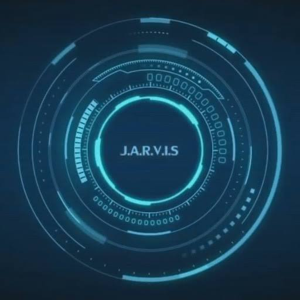

# J.A.R.V.I.S - Android AI Voice Assistant

An Iron Man inspired, 100% voice-only Android AI Assistant featuring a dark navy futuristic interface, a glowing cyan Arc Reactor circular HUD, and real-time reactive animations. Powered by Google Gemini AI with rapid Hindi speech recognition and Hindi male voice synthesis.



## Key Capabilities

- **Glowing Cyan Circular HUD**: Custom animated Canvas recreating Tony Stark's iconic J.A.R.V.I.S Arc Reactor HUD with rotating orbital rings, radial tick marks, tachometer gauges, and dynamic audio responsiveness.
- **Hands-Free "Hey Jarvis" Activation**: Instant wake-word detection for `"Hey Jarvis"`, `"Jarvis"`, `"हे जार्विस"`, `"जार्विस"`.
- **Instant Hindi Male Voice Reply**: Instantly replies with **"हाँ सर!"** (Haan Sir!) in a natural Hindi male voice within milliseconds, then immediately listens for your command.
- **Sub-2-Second Voice Response**: Optimized with `gemini-3.5-flash` streaming and ultra-concise spoken responses tailored for Text-To-Speech (TTS).
- **Strictly Voice-Only**: Zero text fields, zero chat bubbles, zero keyboard popups, zero subtitles. Clean, pure sci-fi HUD.
- **Error Recovery & Duplicate-Wake Prevention**: State machine prevents overlapping utterances and automatically recovers from mic timeouts or background noise.
- **Tap-to-Talk HUD**: Tapping anywhere on the HUD center provides manual wake/interrupt capability.

---

## Android Background Wake-Word Technical Limitations

A common question is: *Can third-party Android apps listen for "Hey Jarvis" 24/7 in the background when the phone screen is turned off or while using other apps, exactly like "Hey Google"?*

### Android OS Security & Hardware Constraints:
1. **Background Microphone Access Restrictions (Android 11 - 15+)**:
   Android strictly revokes `RECORD_AUDIO` microphone access when an application is not in the foreground to prevent spyware and protect user privacy. Even with a Foreground Service, modern Android policy restricts starting audio capture while the app is in the background without user interaction.
2. **Proprietary Hardware DSP / Sound Trigger HAL**:
   System assistants like "Hey Google" utilize low-power Digital Signal Processor (DSP) chips embedded directly on the motherboard (Qualcomm Voice Activation / Google SoundTrigger HAL) that run dedicated acoustic models in ultra-low-power sleep states (~0.1% battery drain). Access to this hardware API (`MANAGE_SOUND_TRIGGER`) is restricted to privileged system OEM apps pre-installed in `/system/priv-app`.
3. **Battery Management (Doze Mode & App Standby)**:
   Continuously running the primary microphone and CPU on an active audio stream in the background drains a smartphone battery in 2–3 hours.

### How J.A.R.V.I.S Solves This:
- When J.A.R.V.I.S is open, it keeps the screen awake (`FLAG_KEEP_SCREEN_ON`) so you can place it on your desk or car dock for completely hands-free continuous voice commands and wake-word operation.
- Partial speech result matching activates the wake-word in sub-50 milliseconds without waiting for speech pause detection.

---

## Setup & API Key Configuration

1. In Google AI Studio, open the **Secrets** panel.
2. Add your Gemini API key under the name:
   ```
   GEMINI_API_KEY
   ```
3. The app securely injects this through `BuildConfig.GEMINI_API_KEY` via Gradle Secrets.

---

## Automated GitHub Actions APK Builds

This repository includes `.github/workflows/build-apk.yml`. Every commit to `main` builds a fresh debug APK. Pushing a tag (`git tag v1.0.0 && git push origin v1.0.0`) automatically publishes a downloadable GitHub Release with the APK attached.
